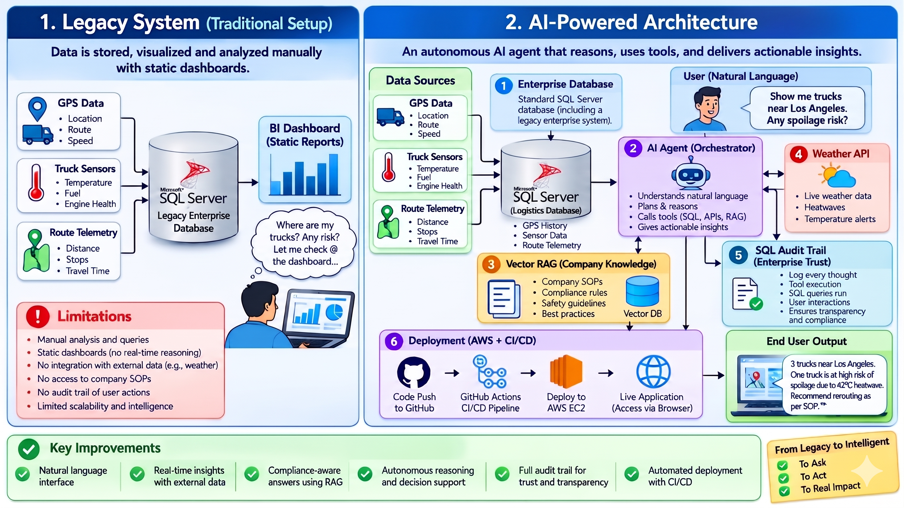

# 🚚 Cold Chain Logistics AI Assistant
### An Autonomous AI-Powered Enterprise Logistics Intelligence System

<p align="center">
  <strong>From Legacy Logistics Monitoring to Intelligent Decision-Making</strong>
</p>

<p align="center">
  An AI-powered logistics assistant integrating enterprise SQL Server, LangGraph, Pinecone RAG, live weather data, and AWS deployment to identify cold-chain risks and deliver actionable operational insights.
</p>

---

## 📌 1. Project Overview

Traditional cold-chain logistics systems rely on static BI dashboards, manual SQL queries, and human-driven investigation to monitor fleet operations and identify potential cargo spoilage risks.

These systems have limited reasoning capabilities, lack contextual access to company policies, and require dispatchers to manually investigate shipment anomalies.

The **Cold Chain Logistics AI Assistant** transforms this traditional approach into an autonomous AI-powered decision-support system.

Built using Python, LangGraph, LangChain, SQL Server, Pinecone, and Streamlit, the application enables users to interact with logistics data through natural language.

The AI agent can:

- Query enterprise logistics data through a secure SQL Server semantic view.
- Retrieve GPS coordinates, cargo temperatures, shipment conditions, and risk classifications.
- Access live weather information using the Open-Meteo API.
- Retrieve company Standard Operating Procedures (SOPs) using Retrieval-Augmented Generation (RAG).
- Reason across multiple tools to identify potential cold-chain and route-related risks.
- Generate contextual recommendations based on retrieved operational data and company policies.
- Maintain an SQL-based audit trail of agent interactions and tool executions.

The application provides an interactive Streamlit dispatch console and a separate enterprise audit-log interface.

---

## 🏗️ 2. System Architecture

### Complete Architecture Diagram



*The architecture illustrates the transition from a traditional SQL Server and static BI reporting environment to an autonomous AI agent architecture.*

> To display this diagram, upload the supplied architecture image into the repository's `docs/` folder and name it `architecture.png`.

### Architecture Components

#### 1. Enterprise Database – Microsoft SQL Server

The SQL Server database acts as the central storage layer for logistics and fleet telemetry.

The system uses a legacy enterprise table:

`dbo.TBL_SC_FLEET_HIST_RAW`

The raw dataset is transformed into a legacy-style database schema containing:

- Timestamp
- GPS latitude and longitude
- IoT cargo temperature
- Cargo condition
- Risk classification
- Delay probability
- Port congestion level
- Route risk index

A semantic database view translates legacy column names into meaningful business-friendly fields.

`FDE_VIEWS.VW_ACTIVE_FLEET`

#### 2. AI Agent – LangGraph Orchestrator

The AI agent acts as the central reasoning and orchestration layer.

Implemented using LangGraph, it contains:

- Reasoning Node – Processes user questions and decides which tools to invoke.
- Tool Node – Executes the selected tools.
- Conditional Routing – Determines whether the agent should execute tools or return a final response.

The agent uses a configurable LLM backend.

Supported configurations in the orchestrator include:

- OpenAI
- DeepSeek
- OrcaRouter
- Local Ollama

The agent follows a tool-calling workflow to retrieve information, interpret results, and generate contextual responses.

#### 3. Vector RAG – Company Knowledge

The RAG component connects the AI agent to company policies and operational knowledge.

Implemented using:

- LangChain
- Pinecone Vector Database
- OpenAI Embeddings or HuggingFace Embeddings
- BAAI/bge-m3 as the default local embedding model

The SOP ingestion pipeline:

1. Reads policy documents from `data/policy/`.
2. Extracts text from Markdown, TXT, PDF, CSV, and Excel documents.
3. Splits documents into smaller chunks.
4. Generates vector embeddings.
5. Stores document chunks in Pinecone.
6. Uses file hashes to avoid unnecessary re-ingestion of unchanged documents.

The agent retrieves the two most relevant documents or chunks through its configured retriever.

#### 4. Weather API – External Data Integration

The application integrates the Open-Meteo API to retrieve current weather conditions using latitude and longitude.

The integration retrieves:

- External temperature.
- Wind speed.
- Weather information for the requested coordinates.

The current implementation also derives a corridor risk indicator from wind speed:

- Wind speed above 10 km/h: High Transit Disruption (8.5/10).
- Otherwise: Corridor Normal (2.5/10).

Note: This corridor index is a rule-based heuristic in the current implementation, not a direct traffic congestion measurement.

#### 5. SQL Audit Trail – Enterprise Trust

The application records agent execution information in:

`FDE_VIEWS.AgentAuditLog`

The audit table stores:

- Log ID
- Timestamp
- Session ID
- Executed graph node
- Tool name
- Execution content

The Streamlit application also provides a dedicated Security & Audit Logs interface for authorized administrators.

#### 6. Deployment – AWS and CI/CD

The application is deployed to AWS EC2.

The deployment workflow uses:

- GitHub repository
- GitHub Actions
- SSH-based deployment
- AWS EC2
- Python virtual environment
- Linux systemd service
- Streamlit

The GitHub Actions workflow is configured for manual deployment through `workflow_dispatch`.

---

## 🔄 3. End-to-End Execution Workflow

```text
              USER
                |
                v
        STREAMLIT UI
                |
                v
       LANGGRAPH AGENT
                |
                v
         REASONING NODE
                |
          Tool Selection
                |
                v
           TOOL NODE
                |
      +---------+----------+
      |         |          |
      v         v          v
  SQL Server  Open-Meteo  Pinecone
  Telemetry    Weather     Vector DB
      |         API         |
      +---------+----------+
                |
                v
       TOOL RESULTS RETURN
                |
                v
         REASONING NODE
                |
                v
       CONTEXTUAL ANALYSIS
                |
                v
       OPERATIONAL RESPONSE
                |
          +-----+------+
          |            |
          v            v
       USER UI     SQL AUDIT LOG
```

### Example User Query

**User:**

> Find active shipments near Los Angeles. Check the local weather and tell me whether the cargo temperature violates the SOP for fresh perishables.

### Agent Execution

1. The user submits a natural-language query through Streamlit.
2. LangGraph invokes the reasoning node.
3. The agent selects the required tools.
4. SQL Server retrieves matching shipment telemetry.
5. Open-Meteo provides current weather conditions.
6. Pinecone retrieves relevant cold-chain SOP clauses.
7. The agent evaluates the returned information against the retrieved SOP.
8. The application records tool execution and generated responses in the SQL audit table.
9. The final incident report is displayed in the Streamlit interface.

---

## 🛠️ 4. Technology Stack

| Category | Technologies |
|---|---|
| Programming Language | Python 3.12 |
| AI Agent Framework | LangGraph |
| LLM Integration | LangChain, OpenAI-compatible LLM APIs, Ollama |
| LLM Providers | OpenAI, DeepSeek, OrcaRouter, Ollama |
| Database | Microsoft SQL Server 2022 |
| Database Connectivity | SQLAlchemy, PyODBC |
| Vector Database | Pinecone |
| Embeddings | OpenAI Embeddings, HuggingFace Embeddings |
| Default Embedding Model | BAAI/bge-m3 |
| Document Processing | PyPDF, Pandas, LangChain Text Splitters |
| External API | Open-Meteo |
| Frontend | Streamlit |
| Data Processing | Pandas |
| Version Control | Git, GitHub |
| CI/CD | GitHub Actions |
| Cloud Infrastructure | AWS EC2 |
| Application Server | Streamlit with Linux systemd |

---

## ✨ 5. Key Features

### 🤖 AI-Powered Agent Orchestration

- Natural-language understanding.
- Tool selection and execution.
- Multi-step reasoning.
- Contextual response generation.
- Configurable LLM providers.

### 🗄️ Enterprise SQL Integration

- SQL Server database integration.
- Legacy-to-semantic schema transformation.
- Read-only database access for the AI agent.
- Restricted SELECT-only query execution.
- Shipment telemetry retrieval.

### 📚 Retrieval-Augmented Generation (RAG)

- SOP document ingestion.
- Document parsing and chunking.
- Configurable embedding models.
- Pinecone vector indexing.
- Incremental document ingestion.
- Contextual policy retrieval.

### 🌦️ External Weather Integration

- Current weather retrieval.
- GPS-based weather lookup.
- External temperature and wind-speed information.
- Rule-based corridor risk indicator.

### 🛡️ Enterprise Security and Auditability

- Dedicated SQL agent account.
- Restricted database permissions.
- Semantic database view.
- SQL audit logging.
- Administrator authentication for audit-log access.
- Session-based conversation tracking.

### ☁️ AWS Deployment

- AWS EC2 hosting.
- SSH-based deployment.
- GitHub Actions automation.
- Linux systemd service management.
- Browser-based application access.

---

## 📂 6. Repository Structure

```text
cold-chain-logistics-ai-assistent/
│
├── .github/
│   └── workflows/
│       └── deploy.yml
│
├── .streamlit/
│   └── config.toml
│
├── Misc/
│   └── Materials/
│       ├── FDE-YT-Project-Business-Presentation.pdf
│       └── Technical Design Document (TDD)_
│           Cold-Chain Logistics AI-Assistant.pdf
│
├── data/
│   ├── cache/
│   │   └── ingestion_hash_cache.json
│   │
│   ├── policy/
│   │   └── Cold_Chain_Incident_SOP_v2.md
│   │
│   ├── raw/
│   │   └── dynamic_supply_chain_logistics_dataset.csv
│   │
│   └── source/
│       └── data.txt
│
├── docs/
│   └── instructions.md
│
├── scripts/
│   ├── ingest_legacy_data.py
│   ├── ingest_sop_pinecone.py
│   └── setup_security_and_view.sql
│
├── src/
│   ├── agent_tools.py
│   ├── orchestrator.py
│   ├── prompts/
│   │   └── system_prompt.txt
│   ├── test_api_model.py
│   └── ui.py
│
├── .gitignore
├── requirements.txt
└── README.md
```

### Important Files

| File | Responsibility |
|---|---|
| `src/ui.py` | Streamlit application and audit-log interface |
| `src/orchestrator.py` | LangGraph agent and reasoning workflow |
| `src/agent_tools.py` | SQL, weather and RAG tools |
| `src/prompts/system_prompt.txt` | Agent instructions and response rules |
| `scripts/ingest_legacy_data.py` | CSV-to-SQL Server ingestion |
| `scripts/ingest_sop_pinecone.py` | SOP ingestion and vector indexing |
| `scripts/setup_security_and_view.sql` | SQL semantic view and security configuration |
| `.github/workflows/deploy.yml` | AWS EC2 deployment workflow |
| `requirements.txt` | Python dependencies |
| `docs/instructions.md` | Detailed project setup instructions |

---

## ⚙️ 7. Installation and Setup

### Prerequisites

- Python 3.12
- Git
- Docker
- Microsoft SQL Server 2022
- SQL Server ODBC Driver 18
- Pinecone account and API key
- LLM provider API key or local Ollama installation
- AWS EC2 instance (for deployment)

### Step 1: Clone the Repository

```bash
git clone https://github.com/ameya182003/cold-chain-logistics-ai-assistent.git

cd cold-chain-logistics-ai-assistent
```

### Step 2: Create a Virtual Environment

**Windows**

```bash
python -m venv venv

venv\Scripts\activate
```

**Linux / macOS**

```bash
python3 -m venv venv

source venv/bin/activate
```

### Step 3: Install Dependencies

```bash
pip install -r requirements.txt
```

### Step 4: Configure Microsoft SQL Server

Start a SQL Server 2022 Docker container.

```bash
docker run -e "ACCEPT_EULA=Y" \
  -e "MSSQL_SA_PASSWORD=YOUR_STRONG_PASSWORD" \
  -p 1433:1433 \
  --name legacy-mssql \
  -d mcr.microsoft.com/mssql/server:2022-latest
```

For persistent database storage, use a Docker volume:

```bash
docker run -v mssql_data:/var/opt/mssql \
  -e "ACCEPT_EULA=Y" \
  -e "MSSQL_SA_PASSWORD=YOUR_STRONG_PASSWORD" \
  -p 1433:1433 \
  --name legacy-mssql \
  -d mcr.microsoft.com/mssql/server:2022-latest
```

Ensure SQL Server is running and the ODBC Driver 18 is installed.

### Step 5: Configure Environment Variables

Create a `.env` file in the project root.

```env
# =================================
# SQL SERVER CONFIGURATION
# =================================

SQL_SERVER_HOST=localhost
SQL_SERVER_PORT=1433

SQL_ADMIN_USER=sa
SQL_ADMIN_PASSWORD=YOUR_SQL_ADMIN_PASSWORD

SQL_AGENT_USER=USR_FDE_RO
SQL_AGENT_PASSWORD=YOUR_SQL_AGENT_PASSWORD


# =================================
# PINECONE CONFIGURATION
# =================================

PINECONE_API_KEY=YOUR_PINECONE_API_KEY


# =================================
# EMBEDDING CONFIGURATION
# =================================

Embeddings_model=LOCAL

Local_Embedding_Model=BAAI/bge-m3

# For OpenAI embeddings, set:
# Embeddings_model=OPENAI
# OPENAI_API_KEY=YOUR_OPENAI_API_KEY


# =================================
# AI REASONING CONFIGURATION
# =================================

Agent_llm=DEEPSEEK

DEEPSEEK_API_KEY=YOUR_DEEPSEEK_API_KEY

# Other supported configurations:
# Agent_llm=OPENAI
# Agent_llm=ORCA
# Agent_llm=OLLAMA

# OPENAI_API_KEY=YOUR_OPENAI_API_KEY
# ORCA_API_KEY=YOUR_ORCAROUTER_API_KEY
```

**Important:** The environment variable names are case-sensitive on Linux. Use the exact names shown above.

The default agent configuration is Ollama if `Agent_llm` is not configured.

The Pinecone API key is mandatory for the current RAG implementation.

Never commit `.env` or real credentials to GitHub.

---

## 🗃️ 8. Data Ingestion Pipeline

### Step 1: Ingest Legacy Logistics Data

The project uses the dataset referenced in:

`data/source/data.txt`

The downloaded dataset should be placed at:

`data/raw/dynamic_supply_chain_logistics_dataset.csv`

Run:

```bash
python scripts/ingest_legacy_data.py
```

The ingestion script:

1. Reads the logistics CSV dataset using Pandas.
2. Maps clean dataset columns to legacy enterprise column names.
3. Creates the `SYS_INGEST_FLAG`.
4. Connects to Microsoft SQL Server using SQLAlchemy and PyODBC.
5. Loads the transformed data into:

`dbo.TBL_SC_FLEET_HIST_RAW`

### Step 2: Create the Semantic View and Database Security

Execute:

```text
scripts/setup_security_and_view.sql
```

This script:

- Creates the `FDE_VIEWS` schema.
- Creates `FDE_VIEWS.VW_ACTIVE_FLEET`.
- Maps legacy columns to readable business fields.
- Creates the dedicated AI agent SQL login.
- Grants SELECT permission on the semantic view.
- Denies direct access to the raw legacy table.
- Restricts modifications to the legacy `dbo` schema.

Before execution, replace the example SQL login password in the script with a strong password and use the matching value in `.env`.

### Step 3: Configure the Audit Table

Execute the following SQL as an authorized administrator:

```sql
CREATE TABLE FDE_VIEWS.AgentAuditLog (
    LogID INT IDENTITY(1,1) PRIMARY KEY,
    Timestamp DATETIME DEFAULT GETDATE(),
    SessionID VARCHAR(50),
    NodeExecuted VARCHAR(50),
    ToolName VARCHAR(100),
    Content NVARCHAR(MAX)
);

GRANT INSERT ON FDE_VIEWS.AgentAuditLog
TO USR_FDE_RO;
```

This allows the application to write audit records using the agent account.

### Step 4: Ingest Company SOP Documents

Configure your Pinecone API key in `.env`.

Run:

```bash
python scripts/ingest_sop_pinecone.py
```

The ingestion pipeline:

- Reads supported policy documents from `data/policy/`.
- Extracts document text.
- Splits content into chunks of 600 characters with 60 characters of overlap.
- Generates embeddings.
- Stores document vectors in Pinecone.
- Uses an MD5 hash cache to detect modified or deleted policy documents.
- Uploads document chunks in batches of 100.

The default Pinecone index depends on the selected embedding configuration:

| Embedding Configuration | Pinecone Index |
|---|---|
| Local HuggingFace | `fde-sop-index-local` |
| OpenAI | `fde-sop-index-openai` |

---

## 🤖 9. AI Agent Execution

### Agent Tools

The project implements three core tools in `src/agent_tools.py`.

**Tool 1: `query_telemetry_db`**

Connects to SQL Server and retrieves logistics information from:

`FDE_VIEWS.VW_ACTIVE_FLEET`

It only permits SQL statements beginning with SELECT and returns up to 10 matching rows.

**Tool 2: `fetch_corridor_conditions`**

Connects to Open-Meteo using GPS coordinates.

Returns:
- External temperature.
- Wind speed.
- Derived corridor risk indicator.

**Tool 3: `search_compliance_sop`**

Retrieves relevant SOP content from Pinecone using vector similarity search.

The retriever is configured to return the top two matches.

### LangGraph Orchestration

Run:

```bash
python src/orchestrator.py
```

The orchestrator:

1. Loads the configured LLM.
2. Registers the three tools.
3. Creates the LangGraph state.
4. Initializes the reasoning node.
5. Initializes the tool execution node.
6. Configures conditional routing.
7. Compiles the agent with an in-memory conversation checkpointer.

The agent follows a reasoning-and-tool-execution loop until it generates a final response.

---

## 🖥️ 10. Streamlit Application

Launch the application:

```bash
streamlit run src/ui.py
```

The application provides two main interfaces.

### A. Dispatch Console

The dispatch console provides:

- Natural-language chat interface.
- Logistics telemetry queries.
- Weather and corridor condition retrieval.
- SOP-based compliance analysis.
- AI-generated operational incident reports.
- Visibility into generated tool inputs and outputs.
- Session-based conversation management.

### B. Security & Audit Logs

The audit interface provides:

- Administrator authentication.
- SQL Server audit-log retrieval.
- Execution timestamps.
- Session tokens.
- LangGraph node information.
- Tool execution details.
- Stored execution content.

The application uses a dark-themed Streamlit interface.

---

## 📋 11. Cold-Chain SOP Rules

The repository includes:

`data/policy/Cold_Chain_Incident_SOP_v2.md`

**Document:** Southern California Logistics Operations – Cold-Chain & Transit Anomalies.

**Version:** 2.4

### Temperature Control

| Parameter | SOP Rule |
|---|---|
| Fresh perishables | 0.0°C to 4.0°C |
| Critical breach | Temperature exceeding 4.0°C |
| Immediate mitigation | Contact driver to restart auxiliary cooling unit |
| Additional escalation | If ETA delay exceeds 1 hour, divert to nearest emergency cold-storage facility |

### Route Congestion

For the Port of Long Beach / LA:

- If port congestion exceeds 7.0, standard routing is suspended.
- Active shipments must be diverted to the Inland Empire Overflow Depot in San Bernardino for cross-docking.

### Risk Classification

A shipment must be escalated to the Tier 2 Logistics Manager when both conditions are met:

- Risk classification = High Risk.
- Delay probability > 0.65.

The AI agent is instructed to retrieve SOP rules rather than invent missing thresholds or operational policies.

---

## ☁️ 12. AWS Deployment and CI/CD

The project uses GitHub Actions to deploy the application to AWS EC2 through SSH.

Workflow file:

`.github/workflows/deploy.yml`

### Deployment Workflow

```text
Developer
   |
   v
GitHub Repository
   |
   v
GitHub Actions
   |
   v
Manual Workflow Trigger
   |
   v
SSH Connection
   |
   v
AWS EC2 Instance
   |
   v
Git Pull from Main
   |
   v
Restart Streamlit Service
   |
   v
Live Application
```

### GitHub Actions Configuration

The workflow uses:

- `actions/checkout@v4`
- `appleboy/ssh-action@v1.0.3`
- SSH-based remote execution.

Configure the following secrets in the GitHub Environment used by the workflow (`FDE-COLD`):

| Secret | Purpose |
|---|---|
| `EC2_HOST` | EC2 public IP or hostname |
| `EC2_USER` | EC2 SSH username |
| `EC2_SSH_KEY` | Private SSH key |

The EC2 instance must have the repository cloned at:

`/home/ubuntu/cold-chain-logistics-ai-assistent`

It must also have a configured Python virtual environment and a systemd service named `streamlit`.

### Deployment Execution

The GitHub Actions workflow performs:

```bash
cd /home/ubuntu/cold-chain-logistics-ai-assistent

git pull origin main

source venv/bin/activate

sudo systemctl restart streamlit
```

The workflow is manually triggered from the GitHub Actions tab.

### Streamlit Service

The application is configured to run through systemd.

Example service configuration:

```ini
[Unit]
Description=Streamlit Cold-Chain Dispatch Console
After=network.target

[Service]
User=ubuntu
WorkingDirectory=/home/ubuntu/cold-chain-logistics-ai-assistent
ExecStart=/home/ubuntu/cold-chain-logistics-ai-assistent/venv/bin/streamlit run src/ui.py --server.port=8501 --server.address=0.0.0.0
Restart=always

[Install]
WantedBy=multi-user.target
```

Register and start the service:

```bash
sudo systemctl daemon-reload

sudo systemctl enable streamlit

sudo systemctl start streamlit
```

The application runs on port `8501`.

Ensure the EC2 security group allows the required access and that the application is appropriately secured.

---

## 🔐 13. Security Considerations

The project implements several database security controls.

- Separate administrative and AI agent SQL credentials.
- Read-only SQL access for telemetry queries.
- Semantic views instead of direct raw-table access.
- Explicit denial of access to the raw legacy table.
- Restricted SQL query execution.
- Separate audit-log permissions.
- Administrator authentication for audit inspection.
- Environment-based credential configuration.

**Production security note:** Protect credentials using environment variables or a secrets manager. Restrict network access to SQL Server and the Streamlit application. Use strong passwords and secure SSH key management.

---

## 📈 14. Key Improvements Over Traditional Systems

| Traditional Architecture | AI-Powered Architecture |
|---|---|
| Static BI dashboards | Natural-language interface |
| Manual SQL investigation | AI-driven tool execution |
| Isolated database information | Integrated enterprise data |
| No contextual policy retrieval | Pinecone-powered RAG |
| Limited external integration | Live weather API |
| Manual risk investigation | Contextual AI reasoning |
| Limited execution traceability | SQL audit trail |
| Manual deployment | GitHub Actions CI/CD |

### From Legacy to Intelligent

**To Ask:** Interact with logistics data using natural language.

**To Act:** Execute tools and retrieve contextual information.

**To Real Impact:** Deliver actionable cold-chain risk insights.

---
